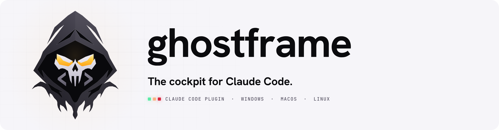
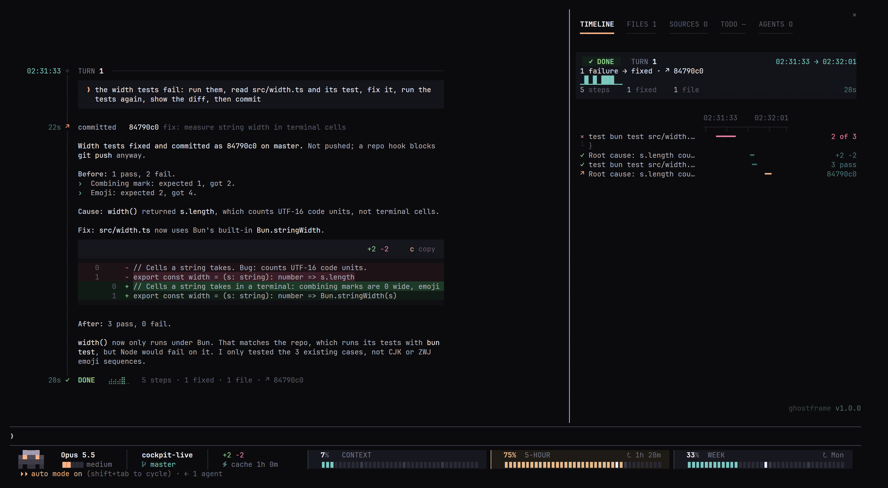
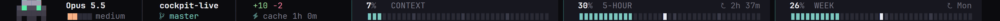
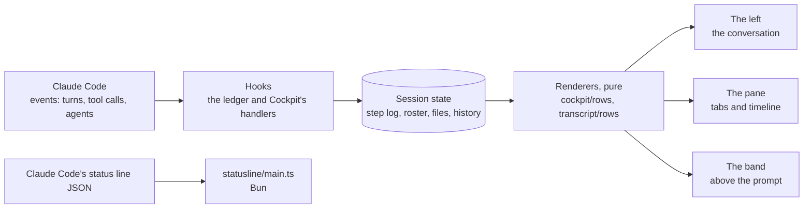

<picture>
  <source media="(prefers-color-scheme: dark)" srcset="docs/design/brand/readme/readme-hero-dark.png">
  
</picture>

**The cockpit for Claude Code.** A redesigned chat UI with a live view of the work, and a status line that shows what
your session costs.

[](https://github.com/tashfiqul-islam/ghostframe/actions/workflows/ci.yml)
[](https://github.com/tashfiqul-islam/ghostframe/releases)
[](LICENSE)
[](.github/workflows/ci.yml)



## What it is

ghostframe is a Claude Code plugin. It changes how your Claude Code session looks in the terminal and adds nothing
to what Claude does. Cockpit puts the conversation on the left and the work on the right: every step of the turn on
a timeline, with the files it changed, the pages it read, its to-do list and its agents. The status line shows the
model, the repository, your context and your 5-hour and weekly budgets in two rows.

ghostframe never reads, stores or sends your credentials or tokens, and it makes no network requests. It runs inside
your own Claude Code session and changes how the session is displayed. It writes to your Claude Code config folder
only when you run `/ghostframe-statusline install` or `uninstall`: the status line's script, its `statusLine` entry in
your user `settings.json`, and a backup of that file. It shows the change and asks first. The status line keeps small
caches of git's answer and your budgets in the system's temp folder.

## Features

### Cockpit

- **The left:** the conversation only. Each turn opens with a header and your message, and ends with a receipt: how
  long it took, what it did and whether it passed.
- **The pane:** docked beside the conversation, with five tabs: Timeline, Files, Sources, Todo and Agents.
- **Receipts and failure cards:** a failed step gets a row that stays, with its first decisive error line. A later fix
  shows as its own step, never as an edit of the failure.
- **Fallback:** when the terminal is too narrow for the pane, the left draws a worked node for each stretch of work,
  a row for each failure and the live step.
- **Rewind:** after `/rewind`, the rewound turn leaves the pane, and the next turn's header says `AFTER REWIND`.

The spec says exactly how each part looks and behaves: [docs/design/cockpit.md](docs/design/cockpit.md).


### The status line

- **Model and effort**, the **repository and branch**, and **your changes** or the **pull request that needs you**.
- **Context**, and the **5-hour and weekly budgets**, each with its pace and the time it resets.
- **The ghost:** its eyes are green under 60% of your highest budget, amber from 60% and red from 85%.



Its design and how it is built: [docs/design/statusline.md](docs/design/statusline.md).

## Install

In a Claude Code session:

```text
/plugin marketplace add tashfiqul-islam/ghostframe
/plugin install ghostframe@ghostframe
```

Or from your shell:

```sh
claude plugin marketplace add tashfiqul-islam/ghostframe
claude plugin install ghostframe@ghostframe
```

Cockpit is on as soon as the plugin loads. To turn it off, set **Cockpit pane** to off in `/config`, or start one
session with `GHOSTFRAME_COCKPIT=0`.

### The status line

Claude Code reads its status line only from settings, so the status line has its own one-time step. In a session:

```text
/ghostframe-statusline install
```

It shows the change to your user `settings.json`, asks before writing, builds the status line with Bun and keeps a
backup. `/ghostframe-statusline uninstall` restores the status line you had before, and
`/ghostframe-statusline status` says what is installed. [The install guide](docs/guide/install.md) covers updates and
uninstalling.

### Requirements

| What        | Needs                                                                                                                                                                       |
| ----------- | --------------------------------------------------------------------------------------------------------------------------------------------------------------------------- |
| Claude Code | The terminal CLI, 2.1.329 up to (not including) 2.2.0. CI tests 2.1.329, live checks ran on 2.1.332. Outside that range ghostframe stays dormant.                           |
| System      | Windows is tested live. macOS and Linux run the tests in CI only.                                                                                                           |
| Terminal    | True colour is best. The status line falls back to 256 colours and respects `NO_COLOR`.                                                                                     |
| Font        | A [Nerd Font](https://www.nerdfonts.com/) for the status line's icons. Without one, turn **Status line icons** off in `/config`, and it draws the same layout without them. |
| Width       | The pane docks from 144 columns, or from 110 after `/cockpit`. Narrower, Cockpit uses its fallback. The status line draws two rows from 90 columns, one line below.         |
| Bun         | [Bun](https://bun.sh) on your `PATH`, for the status line only.                                                                                                             |

## Quick start

The pane takes the keyboard only when you give it. These five keys cover the first minute:

| Key                 | Does                                                                       |
| ------------------- | -------------------------------------------------------------------------- |
| `ctrl+x` then `tab` | Gives the pane the keyboard. `esc` gives it back to the prompt.            |
| `1` to `5`          | Switches tab: Timeline, Files, Sources, Todo, Agents.                      |
| `enter`             | Opens the row: a step's output, a file's diff, an agent, or a URL to copy. |
| `p` / `n`           | Shows the previous or next turn. `l` goes back to the live one.            |
| `ctrl+o`            | Claude Code's full record of the turn, every step with its details.        |

`/cockpit` opens or closes the pane, and `/steps 3` pins turn 3 into it. [Keys](docs/guide/keys.md) lists them all.

## Compatibility

ghostframe runs wherever the `claude` CLI runs in a terminal: Windows Terminal, macOS and Linux terminals, and the
integrated terminals of editors. Windows is tested live, and macOS and Linux only in CI. It does not run in other
agent tools, such as OpenCode or Codex, which have their own UI and don't load Claude Code plugins.

## How it works

ghostframe is a hooks module that Claude Code loads in the session. The engine raises an event for each thing that
happens. ghostframe keeps what it needs in the session's state, and pure renderers turn that state into rows for
three places: the left, the pane and the band above the prompt.



The status line is a separate program: Claude Code runs it with the session's state as JSON on its input.
[docs/architecture.md](docs/architecture.md) has the details, and [hooks/README.md](hooks/README.md) the module
layout and its rules.

## Docs

The [docs index](docs/README.md) lists everything. The most used:

- Guide: [install](docs/guide/install.md), [usage](docs/guide/usage.md), [keys](docs/guide/keys.md),
  [configuration](docs/guide/configuration.md), [troubleshooting](docs/guide/troubleshooting.md)
- [Architecture](docs/architecture.md) and the [decisions](docs/decisions/README.md) behind it
- Specs: [Cockpit](docs/design/cockpit.md) and the [status line](docs/design/statusline.md)
- Development: [testing](docs/development/testing.md), [the live checks](docs/development/live-checks.md),
  [releasing](docs/development/releasing.md)

## Development

```sh
mise run setup                    # dev tools and the git hooks
bun run --cwd tools test          # the plugin's tests (claude plugin test)
bun run --cwd tools test:statusline
mise run check                    # the whole gate: types, lint, format, validation, tests, workflows, docs
```

The live checks drive a real Claude Code in a pseudo-terminal and check what it draws:
[tools/live/README.md](tools/live/README.md). The README's screenshots come from them:
[docs/assets/README.md](docs/assets/README.md).

## Contributing

Issues and pull requests are welcome. Commits and PR titles follow [Conventional Commits](https://www.conventionalcommits.org/),
which CI checks, and releases are made from them: [docs/development/releasing.md](docs/development/releasing.md).

## License

[MIT](LICENSE)
