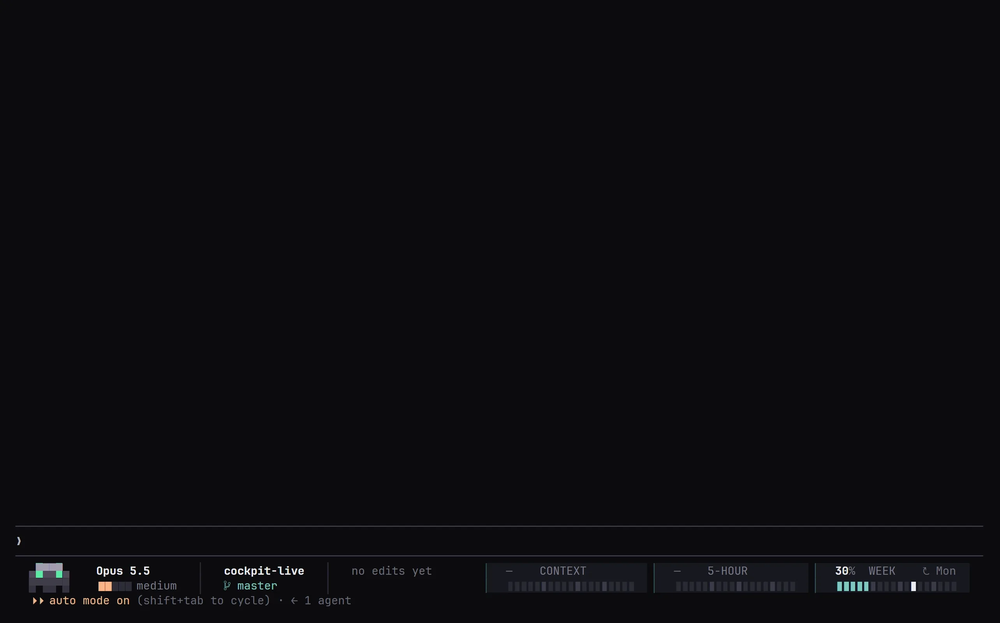
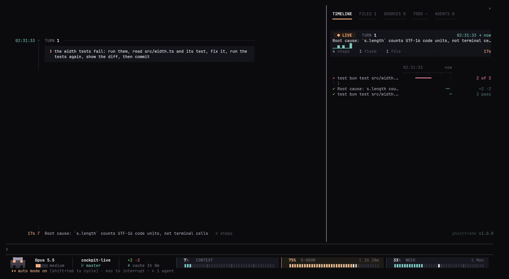

<p align="center">
  <picture>
    <source media="(prefers-color-scheme: dark)" srcset="docs/design/brand/readme/readme-hero-dark.png">
    
  </picture>
</p>

<h3 align="center">See what Claude is doing while it does it.</h3>

<p align="center">
  A redesigned chat UI for Claude Code, with every step of the turn on a live timeline,<br>
  and a status line that shows what your session is costing you.
</p>

<!-- tools/scripts/engines.ts --check fails if the Claude Code badge's or the SPEC box's range disagrees with plugin.json's engines. -->
<!-- The version is alone on its line with the marker: release-please rewrites the semver on it (tools/scripts/readme.ts checks). -->
<p align="center">
  <a href="https://github.com/tashfiqul-islam/ghostframe/actions/workflows/ci.yml"></a>
  <a href="docs/guide/compatibility.md"></a>
  <a href="LICENSE"></a>
  <code>v1.0.0</code> <!-- x-release-please-version -->
</p>

<!-- The designed images below are drawn by tools/scripts/readme-art.ts. -->
<p align="center">
  <a href="docs/guide/compatibility.md"><picture><source media="(prefers-color-scheme: dark)" srcset="docs/assets/readme/platforms-dark.svg"></picture></a>
</p>

<p align="center"><picture><source media="(prefers-color-scheme: dark)" srcset="docs/assets/readme/divider-dark.svg"></picture></p>

<p align="center">
  <picture>
    <source media="(max-width: 600px) and (prefers-color-scheme: dark)" srcset="docs/assets/readme/features-narrow-dark.svg">
    <source media="(max-width: 600px)" srcset="docs/assets/readme/features-narrow-light.svg">
    <source media="(prefers-color-scheme: dark)" srcset="docs/assets/readme/features-dark.svg">
    
  </picture>
</p>

<p align="center"><picture><source media="(prefers-color-scheme: dark)" srcset="docs/assets/readme/divider-dark.svg"></picture></p>

<p align="center">
  <b><a href="#02-install">Install</a></b> ·
  <a href="#01-features">Features</a> ·
  <a href="#03-keys">Keys</a> ·
  <a href="docs/README.md">Docs</a> ·
  <a href="https://github.com/tashfiqul-islam/ghostframe/releases">Changelog</a>
</p>

<!-- docs/assets/README.md says how to record the demo again; with reduced motion the still shows instead. -->
<p align="center">
  <picture>
    <source media="(prefers-reduced-motion: reduce)" srcset="docs/assets/readme-hero.png">
    
  </picture>
</p>

**Install**, in a Claude Code session ([every step](#02-install)):

```text
/plugin marketplace add tashfiqul-islam/ghostframe
/plugin install ghostframe@ghostframe
```

> [!NOTE]
> **Private by design.** ghostframe runs inside your own Claude Code session. It makes no network requests and never
> reads, stores or sends your credentials. The [security policy](SECURITY.md) has the threat model.

<!-- tools/scripts/readme.ts --check fails if a line of a box here is not as wide as its top rule. -->

```text
+-------------------------- [ SPEC ] --------------------------+
|                                                              |
| plugin       a Claude Code hooks module, nothing to install  |
| cockpit      the conversation left, the turn's work right    |
| status line  model, repo, context, 5-hour and weekly budgets |
| network      none: no requests, no telemetry, no credentials |
| engine       Claude Code 2.1.329 to 2.1.x, dormant outside   |
| systems      Windows, Linux, macOS                           |
| license      MIT                                             |
|                                                              |
+--------------------------------------------------------------+
```

## `01` Features

**Cockpit** keeps the conversation on the left and puts the work on the right: each step of the turn on a timeline, the
files it changed, the pages it read, its to-do list and its agents. **The status line** gives you the model, the
repository, your context and your 5-hour and weekly budgets in two rows.

<table>
<tr>
<td width="44%" valign="middle">

### A live timeline

Every step of the turn on a time track, grouped as Claude works. A failure gets a row that stays, with its first
decisive line; the fix shows as its own step.

[Usage →](docs/guide/usage.md#the-pane)

</td>
<td width="56%"></td>
</tr>
<tr>
<td width="44%" valign="middle">

### Every file, one key from its diff

The files the turn changed, with their counts and a change bar. `enter` opens the diff against the start of the
turn.

[Keys →](docs/guide/keys.md)

</td>
<td width="56%"></td>
</tr>
</table>

### The status line

<p align="center">
  
</p>

The model and its effort, the repository and branch, your changes or the pull request that needs you, then context and
the 5-hour and weekly budgets, each with its pace and reset time. The ghost's eyes show the highest of the three:
green under 60%, amber from 60%, red from 85%. [The design →](docs/design/statusline.md)

**And the details.** The left stays quiet: a header for each turn, your message, Claude's answer, a row for anything
that left the machine, and a receipt with how long the turn took and whether it passed. Narrow terminals get a
fallback without the pane. The pane follows Claude's agents into their own work, steps back through earlier turns, and
knows when you rewind. [The spec →](docs/design/cockpit.md)

## `02` Install

In a Claude Code session:

```text
/plugin marketplace add tashfiqul-islam/ghostframe
/plugin install ghostframe@ghostframe
```

Cockpit is on as soon as the plugin loads. The status line is a one-time step of its own, because Claude Code reads its
status line only from your settings:

```text
/ghostframe-statusline install
```

It shows the change to your `settings.json`, asks first, and keeps a backup. `uninstall` restores what you had.

<details>
<summary><b>From your shell, updates, and uninstalling</b></summary>

```sh
claude plugin marketplace add tashfiqul-islam/ghostframe
claude plugin install ghostframe@ghostframe
claude plugin update ghostframe@ghostframe       # then /ghostframe-statusline install again
claude plugin uninstall ghostframe@ghostframe    # after /ghostframe-statusline uninstall
```

The [install guide](docs/guide/install.md) has every step.

</details>

| Requirement | Detail                                                                                                    |
| ----------- | --------------------------------------------------------------------------------------------------------- |
| Claude Code | The terminal CLI, 2.1.329 up to (not including) 2.2.0. On any other version ghostframe stays dormant.     |
| Terminal    | True colour is best; the status line falls back to 256 colours and honours `NO_COLOR`.                    |
| Width       | The pane docks from 144 columns, or from 110 after `/cockpit`. The status line draws two rows from 90.    |
| Font        | A [Nerd Font](https://www.nerdfonts.com/) for the status line's icons, or turn **Status line icons** off. |
| Bun         | [Bun](https://bun.sh), for the status line only.                                                          |

## `03` Keys

Cockpit's keys work only while the pane has the keyboard, so they never take one from your prompt.

```text
+-------------------------- [ KEYS ] --------------------------+
|                                                              |
| [ctrl][x] then [tab]  give the pane the keyboard             |
| [1] … [5]             timeline, files, sources, todo, agents |
| [enter]               open the row: output, diff, agent, url |
| [p] [n]               the previous or next turn, [l] live    |
| [ctrl][o]             Claude Code's full record of the turn  |
| [esc]                 back to the prompt                     |
|                                                              |
+--------------------------------------------------------------+
```

`/cockpit` opens or closes the pane, and `/steps 3` pins turn 3 into it. [Every key →](docs/guide/keys.md)

## `04` How it works

ghostframe is a hooks module that Claude Code loads into your session. It listens to the engine's events, keeps what
each turn did, and draws through the engine's own render sites, so it never writes to your terminal behind Claude
Code's back.

<p align="center">
  <picture>
    <source media="(prefers-color-scheme: dark)" srcset="docs/assets/diagrams/architecture-dark.png">
    
  </picture>
</p>

Outside the Claude Code versions it is tested with, ghostframe goes dormant and hands every row back to Claude Code.
[Architecture →](docs/architecture.md) · [Decisions →](docs/decisions/README.md)

## `05` Where it runs

```text
+--------------------- [ WHERE IT RUNS ] ----------------------+
|                                                              |
| Where                       | Cockpit      | Status line     |
| ----------------------------+--------------+-------------    |
| Systems                                                      |
| Windows                     | tested live  | tested live     |
| Linux                       | CI           | CI, WSL         |
| macOS                       | CI           | CI              |
| ----------------------------+--------------+-------------    |
| Claude Code                                                  |
| terminal CLI                | yes          | yes             |
| Desktop app, VS Code panel  | hands back   | —               |
| web                         | —            | —               |
|                                                              |
+--------------------------------------------------------------+
```

ghostframe runs wherever the `claude` CLI runs in a terminal: editors' integrated terminals included, and hosts that
run the real `claude` binary. Other agent tools, such as OpenCode or Codex, don't load Claude Code plugins, so it
doesn't run there.
[Compatibility →](docs/guide/compatibility.md)

## `06` FAQ

<details open>
<summary><b>Does it change what Claude does?</b></summary>

No. Prompts, tools, permissions and answers stay Claude Code's; ghostframe changes only how they are drawn.

</details>

<details>
<summary><b>How do I turn Cockpit off?</b></summary>

Turn **Cockpit pane** off in `/config`, or set `GHOSTFRAME_COCKPIT=0` for one session.
[Configuration](docs/guide/configuration.md) lists every option.

</details>

<details>
<summary><b>The status line shows empty boxes.</b></summary>

Its icons need a [Nerd Font](https://www.nerdfonts.com/). Set one in your terminal, or turn **Status line icons**
off in `/config`; the layout stays the same.

</details>

<details>
<summary><b>My Claude Code version is newer than the supported range.</b></summary>

On a Claude Code outside its tested range, ghostframe goes dormant: it draws nothing, Claude Code draws everything
itself, and the session says so once; the status line keeps working. `GHOSTFRAME_ENGINE_CHECK=0` runs it anyway, but
its look may break on a version it was not tested with. [Compatibility](docs/guide/compatibility.md) has the range.

</details>

<details>
<summary><b>Can I keep my own status line?</b></summary>

Yes. ghostframe's status line is opt-in (`/ghostframe-statusline install`), and
`/ghostframe-statusline uninstall` puts yours back ([Install](docs/guide/install.md#the-status-line)).

</details>

<details>
<summary><b>Does ghostframe send anything anywhere?</b></summary>

No. It has no network code: it reads what Claude Code gives it, your project's files and `git`'s answers, and never
your credentials. It writes only Claude Code's plugin store (Cockpit's turn history), the status line's build and its
per-user cache folder, and, when you install the status line, `settings.json`'s `statusLine` entry after a backup;
[SECURITY.md](SECURITY.md#threat-model) has the details.

</details>

<details>
<summary><b>How do I uninstall it?</b></summary>

If you installed the status line, run `/ghostframe-statusline uninstall` first: it restores the status line you had
before. Then run `/plugin marketplace remove ghostframe`; removing the marketplace also uninstalls ghostframe.
[Install](docs/guide/install.md#uninstall) has the same steps from your shell.

</details>

[Configuration →](docs/guide/configuration.md) · [Troubleshooting →](docs/guide/troubleshooting.md) ·
[Nerd Fonts →](https://www.nerdfonts.com/)

## `07` Docs

| Use it                                           | Understand it                                 | Work on it                                     |
| ------------------------------------------------ | --------------------------------------------- | ---------------------------------------------- |
| [Install](docs/guide/install.md)                 | [Architecture](docs/architecture.md)          | [Contributing](CONTRIBUTING.md)                |
| [Usage](docs/guide/usage.md)                     | [Decisions](docs/decisions/README.md)         | [Testing](docs/development/testing.md)         |
| [Keys](docs/guide/keys.md)                       | [Cockpit spec](docs/design/cockpit.md)        | [Live checks](docs/development/live-checks.md) |
| [Configuration](docs/guide/configuration.md)     | [Status line spec](docs/design/statusline.md) | [Releasing](docs/development/releasing.md)     |
| [Troubleshooting](docs/guide/troubleshooting.md) | [Security](SECURITY.md)                       | [Brand kit](docs/design/brand/README.md)       |
| [Compatibility](docs/guide/compatibility.md)     |                                               | [All docs](docs/README.md)                     |

## `08` Contributing

Issues and pull requests are welcome. [CONTRIBUTING.md](CONTRIBUTING.md) covers setup, the checks and how a change
ships; everyone here follows the [Code of Conduct](CODE_OF_CONDUCT.md).

```sh
mise install && mise run setup    # the toolchain and the git hooks
mise run check                    # types, lint, format, tests, workflows, docs
```

<br>

<p align="center">
  
  <br>
  <sub><code>ghostframe</code> haunts your terminal, never your code.</sub>
  <br>
  <sub><a href="LICENSE">MIT</a> · Made for Claude Code. Not affiliated with or endorsed by Anthropic.</sub>
</p>
