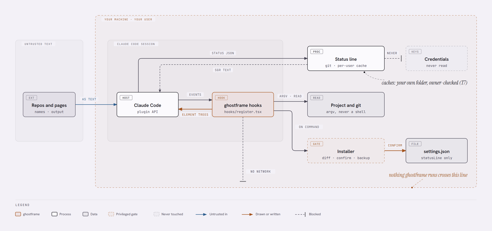

# Security policy

ghostframe changes how Claude Code looks in your terminal. It runs inside your own Claude Code session, makes no
network requests, and never reads, stores or sends your credentials. This page says how to report a problem, what is
in scope, and the threat model behind those claims.

- [Report a vulnerability](#report-a-vulnerability)
- [Supported versions](#supported-versions)
- [Scope](#scope)
- [Threat model](#threat-model)
- [Hardening](#hardening)

## Report a vulnerability

Report it privately. Don't open a public issue, discussion or pull request for it.

1. Open the repository's **Security** tab and choose **[Report a vulnerability](https://github.com/tashfiqul-islam/ghostframe/security/advisories/new)**.
   Only the maintainers can read the report.
2. Include what an attacker can do, how to reproduce it, the ghostframe version (the pane's last row, or
   `claude plugin list`), the Claude Code version (`claude --version`) and your OS and terminal.

What happens next:

| Step    | What the maintainer does                                                            |
| ------- | ----------------------------------------------------------------------------------- |
| Triage  | Confirms the report on the advisory and asks for anything missing.                  |
| Fix     | Prepares the fix in the advisory's private fork, with a test that fails without it. |
| Release | Ships it in a release, and publishes the advisory with a CVE where one applies.     |
| Credit  | Credits you in the advisory, unless you'd rather not be named.                      |

Please give the fix a chance to ship before you share details. A report about Claude Code itself goes to Anthropic, not
here: see [Claude Code's security reporting](https://code.claude.com/docs/en/legal-and-compliance#security-vulnerability-reporting).

## Supported versions

| Version         | Fixes |
| --------------- | ----- |
| 1.x, the latest | Yes   |
| Anything older  | No    |

ghostframe runs only on the Claude Code versions in its tested range (`engines` in `plugin.json`); on any other it
stays dormant ([ADR 0012](docs/decisions/0012-engine-range.md)).

## Scope

**In scope:** the plugin (`hooks/`), the status line (`statusline/`), its installer command, the manifests in
`.claude-plugin/`, and this repository's release and CI pipeline.

**Out of scope:**

- Claude Code itself, its permission system, and what Claude does with its tools. ghostframe draws what happens; it
  does not decide what runs.
- The development tools in `tools/` and `docs/assets/`, which are never installed for users, except where they could
  affect a release.
- Problems that need an attacker who already controls your user account, your Claude Code settings or your
  environment variables.

## Threat model

### What runs, and where

| Part                  | Where it runs                                                                                  | Runs as |
| --------------------- | ---------------------------------------------------------------------------------------------- | ------- |
| The hooks module      | Inside your Claude Code session, through the engine's plugin API (`hooks/register.tsx`)        | You     |
| The status line       | A separate process Claude Code starts on each refresh: `bun <config>/ghostframe/statusline.js` | You     |
| The installer command | `/ghostframe-statusline install \| uninstall \| status`, inside the session, when you run it   | You     |

ghostframe has no server, no background service and no network code. It never writes to the terminal directly from the
session: Cockpit returns element trees and Claude Code draws them. Only the status line writes terminal text, through
one function (`statusline/ansi.ts`).

  <picture>
    <source media="(prefers-color-scheme: dark)" srcset="docs/assets/diagrams/trust-boundaries-dark.png">
    
  </picture>

### What it protects

- **Your credentials and session**: Claude Code's sign-in, API keys and tokens. ghostframe never reads them.
- **Your settings**: `settings.json` is changed only by the installer, only its `statusLine` entry, and only after you
  confirm.
- **Your files**: ghostframe reads project files to show diffs and never writes them.
- **Your terminal**: text from outside must not become escape sequences.
- **The release**: what users install must be what this repository built.

### Who could attack it

| Actor                              | Reaches ghostframe through                                                                   |
| ---------------------------------- | -------------------------------------------------------------------------------------------- |
| A repository you open              | File and folder names, branch names, file contents, the output of commands Claude runs in it |
| A web page Claude fetches          | Its title and URL, shown in the Sources tab                                                  |
| Another user on a shared machine   | Files they can write where the status line looks for its caches                              |
| A compromised dependency or action | The development and release pipeline                                                         |

### Threats and mitigations

| #   | Threat                                                           | Mitigation                                                                                                                                                                                                                                                                                                                                                                                                                                                                                                                                                               | Residual risk                                                                                                             |
| --- | ---------------------------------------------------------------- | ------------------------------------------------------------------------------------------------------------------------------------------------------------------------------------------------------------------------------------------------------------------------------------------------------------------------------------------------------------------------------------------------------------------------------------------------------------------------------------------------------------------------------------------------------------------------ | ------------------------------------------------------------------------------------------------------------------------- |
| T1  | Escape sequences hidden in a name or output reach the terminal   | Cockpit draws through Claude Code's element trees, never raw output. The status line removes every C0 and C1 control from its text before printing; only its own SGR colour escapes go out (`statusline/ansi.ts`, with a test).                                                                                                                                                                                                                                                                                                                                          | None known.                                                                                                               |
| T2  | A crafted file name injects options or commands into `git`       | Every process is started with an argument list, never a shell, and paths follow `--` (`git diff HEAD -- <path>`).                                                                                                                                                                                                                                                                                                                                                                                                                                                        | None known.                                                                                                               |
| T3  | ghostframe reads files outside the project                       | Files outside the project are listed but never read or diffed ([ADR 0007](docs/decisions/0007-outside-project-files-not-diffed.md)).                                                                                                                                                                                                                                                                                                                                                                                                                                     | None known.                                                                                                               |
| T4  | The installer damages or rewrites your settings                  | It shows the exact diff, writes nothing before you confirm, changes only `statusLine`, keeps a timestamped backup, and keeps the entry it replaced so `uninstall` restores it.                                                                                                                                                                                                                                                                                                                                                                                           | A project's own `.claude/settings.json` can set another status line; that is Claude Code's precedence, shown by `status`. |
| T5  | Credentials or session data leave the machine                    | No network code anywhere in the plugin or the status line; no credential file or key is read. The status line reads only the JSON Claude Code gives it, git's answer, its own caches, the icons option, and a fixture file only when `GF_FIXTURE` names one (a test hook for the live checks).                                                                                                                                                                                                                                                                           | None known.                                                                                                               |
| T6  | A page title is used to mislead                                  | Titles are shown as text, cut to fit, never invented ([ADR 0006](docs/decisions/0006-never-invent-a-page-title.md)). `enter` copies a URL; ghostframe never opens one.                                                                                                                                                                                                                                                                                                                                                                                                   | A page can still choose a misleading title.                                                                               |
| T7  | Another local user tampers with the status line's caches         | Mitigated. The caches and the debug log live in a per-user cache folder, never the shared temp folder: `%LOCALAPPDATA%\ghostframe\cache` on Windows, `~/Library/Caches/ghostframe` on macOS, `$XDG_CACHE_HOME/ghostframe` (or `~/.cache/ghostframe`) on Linux. The folder is created readable only by you (`0700`), each file `0600`. A cache file is read only when it is a regular file you own: links are refused and opened with `O_NOFOLLOW`, and ownership is checked on the open descriptor (`statusline/io.ts`, with tests). Files are written whole, by rename. | None known. On Windows the per-user profile folder's access control is the boundary, as there are no user ids to compare. |
| T8  | Untrusted input exhausts memory or stalls a render               | The turn history is capped at 4,194,304 characters, a diff at 5,000 lines; `git` in the status line times out after 800 ms and is cached for 5 s; the status line never throws and draws what it has.                                                                                                                                                                                                                                                                                                                                                                    | None known.                                                                                                               |
| T9  | ghostframe draws a broken UI on an engine it was not tested with | Outside the tested Claude Code range it stays dormant and says so ([ADR 0012](docs/decisions/0012-engine-range.md)).                                                                                                                                                                                                                                                                                                                                                                                                                                                     | `GHOSTFRAME_ENGINE_CHECK=0` turns the check off, at your choice.                                                          |
| T10 | Copied text lands on the clipboard unexpectedly                  | ghostframe copies only when you press a copy key or run `/copy`.                                                                                                                                                                                                                                                                                                                                                                                                                                                                                                         | None known.                                                                                                               |
| T11 | A compromised dependency, action or release                      | See [Supply chain](#supply-chain).                                                                                                                                                                                                                                                                                                                                                                                                                                                                                                                                       | As for any open-source project, a compromise of GitHub or of the maintainer's account.                                    |

### Supply chain

- **Nothing to install at run time.** The plugin has no `package.json` at its root, so Claude Code installs no
  dependencies; it runs the `.ts` files as they are. The status line is built locally from this repository's source.
- **Pinned and reviewed.** Development tools are pinned in `mise.toml` and lockfiles. GitHub Actions are pinned to
  full commit SHAs. The Claude Code CLI that CI runs is pinned and checked against its SHA-256 for each platform.
  Dependabot proposes updates only after a 14-day cooldown.
- **Checked on every change.** CI audits the workflows (`zizmor`, `actionlint`), reviews dependency changes, and runs
  the OpenSSF Scorecard weekly.
- **Protected `main`.** Changes land through pull requests only, as signed squash merges with linear history and the
  required checks passing; force pushes and deletion are refused ([.github/rulesets](.github/rulesets)).
- **Releases.** release-please opens the release PR and tags the release. It acts through a GitHub App with only the
  contents, pull-request and issue permissions it needs, whose key lives in a `release` environment that only `main`
  can use. Release tags can be neither moved nor deleted.
- **Updates reach you only on a new version.** Claude Code updates an installed plugin when its `version` changes,
  from this repository's marketplace.

## Hardening

- Install ghostframe from this repository's marketplace only: `/plugin marketplace add tashfiqul-islam/ghostframe`.
- Read the diff the installer shows before you confirm it.
- After updating from a version before 1.0.0, run `/ghostframe-statusline install` again, so the status line keeps
  its caches in your own cache folder. Its old files in the system temp folder (`ghostframe-statusline-*`) can be
  deleted.
- Leave `GHOSTFRAME_ENGINE_CHECK` unset unless you are testing a new Claude Code release.
