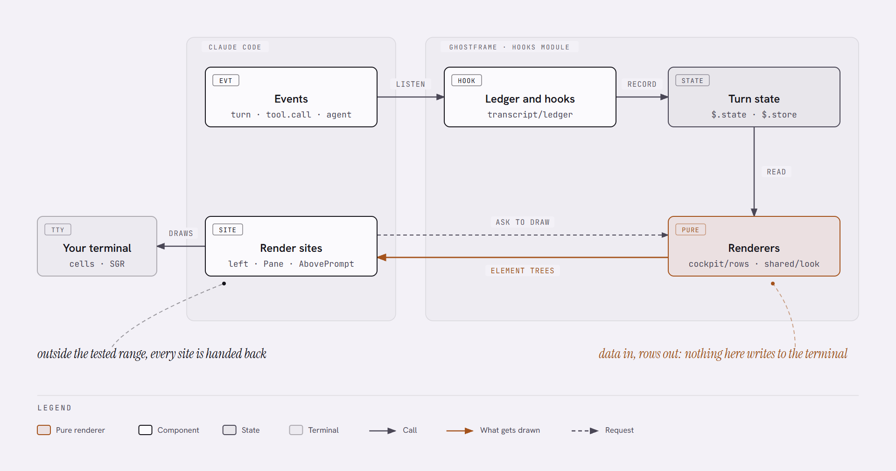

# Architecture

ghostframe is two programs: a hooks module that Claude Code loads into the session (Cockpit and the status line's
installer), and the status line itself, a Bun script Claude Code runs as its `statusLine` command. Neither has a
build step for the plugin: the engine runs the `.ts` files as they are.

## Data flow

  <picture>
    <source media="(prefers-color-scheme: dark)" srcset="assets/diagrams/architecture-dark.png">
    
  </picture>

1. **Events in.** `hooks/register.tsx` composes the features. The transcript's ledger (`hooks/transcript/ledger/`)
   owns the engine's events: session start and resume, turns, prompts, tool calls and checks. It calls the cockpit's
   log where Cockpit needs the main loop. Cockpit hooks its own events: its commands and the agent events.
2. **State.** What a turn did is kept in the session's state: the step log, the agents' roster, the turn's work
   (to-do, files, pages) and every past turn's record. An atom is read and written only in the file that declares it.
3. **Render sites.** The engine asks a plugin to draw at named sites. The transcript's sites restyle the
   conversation; Cockpit draws the `Pane` and the band above the prompt (`AbovePrompt`). While Cockpit is on, the
   conversation's sites ask `cockpit/left` first, which decides between the quiet left (pane docked) and fallback.
4. **Renderers.** `hooks/cockpit/rows/` and `hooks/transcript/rows/` are pure: data in, rows out. Every row is built
   from `hooks/shared/look/`: one palette, one glyph table, one formatter per format, and the spine that lines up the
   label, spine and text columns.

`hooks/README.md` lists every folder and the import rules, which `tools/scripts/boundaries.ts` enforces.

## The engine boundary

ghostframe draws only through the engine's plugin API (render sites, `$.ui`, `$.state`, `$.store`, `$.fs`,
`$.process`, `$.command`). What the engine owns stays the engine's: permission dialogs and question cards, the
`ctrl+o` view's frame, the prompt and its hints, the divider, fonts. The spec's [section 10](design/cockpit.md#10-what-the-engine-owns)
lists each. ghostframe depends on this API and its render sites, which is why CI pins the Claude Code version it tests
with, and why ghostframe is dormant on an engine outside its tested range: every site hands its row back
([ADR 0012](decisions/0012-engine-range.md)).

## Off means off

With Cockpit off, every site passes the engine's own row through or draws the transcript's look as it was before
Cockpit. The transcript keeps its own palette (`hooks/shared/tokens.ts`) for that; Cockpit's is
`hooks/shared/look/palette.ts`.

## The status line

`statusline/main.ts` reads the JSON Claude Code writes on its input, gathers git's answer and the cached rate limits,
renders two rows of styled segments and prints them. It never throws and never writes an error: on any failure it
draws what it has. Its colours come from the same palette module as Cockpit's. The installer
(`hooks/statusline/`) builds it with `bun build` into the Claude Code config folder and writes the `statusLine` entry.

## Budgets

| What                      | Budget                                                                                                                                                     |
| ------------------------- | ---------------------------------------------------------------------------------------------------------------------------------------------------------- |
| Turn history in `$.store` | 4,194,304 characters of JSON (`STORE_MAX`); the oldest parts fold first.                                                                                   |
| A line diff               | 5,000 lines per file (`DIFF_LINES_MAX`).                                                                                                                   |
| Files tab                 | No file read or git run per frame: rows keep the steps' counts, only the selected file is diffed ([ADR 0005](decisions/0005-files-counts-known-limit.md)). |
| Status line, warm         | A whole run under 100 ms with git cached, checked by `statusline/render.spec.ts`; about 55 ms measured.                                                    |
| Status line, git          | At most one `git status` per render, cached 5 s per folder.                                                                                                |
| Rows already drawn        | Never change after their first draw, except where the mode switches (spec, amendment 10).                                                                  |
