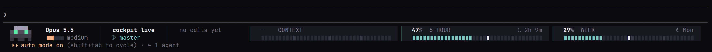
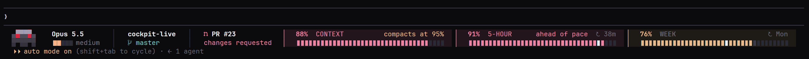
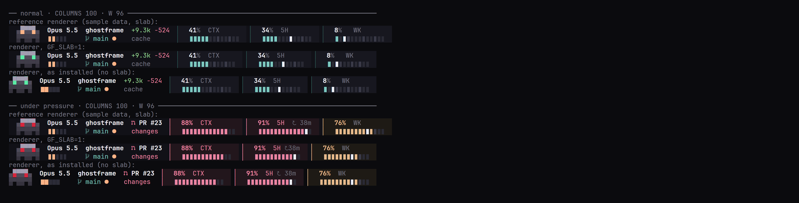
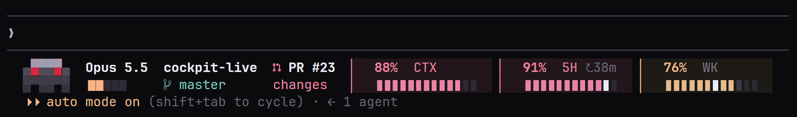

# ghostframe status line

Two rows under Claude Code's prompt: the ghost mark, the model and its effort, the repository and branch, the
session's changes, and three tiles (context, the 5-hour window, the week), each a meter.





The program is [`statusline/`](../../statusline/README.md); `/ghostframe-statusline` installs it. The reference
renderer, [`statusline-preview.ts`](statusline-preview.ts), draws the design with sample data at any width
(`bun docs/design/statusline-preview.ts --width 160`); the program matches it cell for cell
(`statusline/reference.spec.ts`).

## Install

A plugin cannot ship a status line: Claude Code reads `statusLine` from settings files only. So ghostframe installs
it into your user settings, and never silently.

```text
/ghostframe-statusline install     show the diff, ask, then bundle the program, back up settings.json, write
/ghostframe-statusline status      what your user settings run now
/ghostframe-statusline uninstall   put back the statusLine entry that was there before
```

- It needs [Bun](https://bun.sh) on `PATH` and stops with a message when it is missing.
- It bundles `statusline/main.ts` to `~/.claude/ghostframe/statusline.js` (or under `CLAUDE_CONFIG_DIR`), so a plugin
  update never breaks the path, and writes:
  `"statusLine": { "type": "command", "command": "bun <absolute path>/statusline.js", "padding": 0, "refreshInterval": 10 }`.
- It shows the exact diff and asks first. It writes nothing before "Write it": on Cancel or Esc no file changes, the
  bundle included. Then it keeps a backup (`~/.claude/ghostframe/settings.json.bak-<time>`) and changes only the
  `statusLine` entry: every other key, its order, the indentation and the line endings stay as they were.
- The entry it replaced is kept in `~/.claude/ghostframe/statusline-previous.json`; uninstall restores it (or removes
  the entry if there was none). A personal script the old entry pointed at is never touched.
- Only user settings are written. Project settings (`.claude/settings.json`) can also set `statusLine`, and win over
  user settings.

## Terminal setup

The design assumes:

- **Line height 1.5.** Windows Terminal: Settings → your profile → Appearance → Line height 1.5 (stored as
  `font.cellHeight`). VS Code: `terminal.integrated.lineHeight` 1.5.
- **A font with block elements and `▮`** (the meters, the ghost's half blocks, the tile edges `▏`). Drawn and checked
  in GeistMono Nerd Font 11.5.
- **A Nerd Font for the icons** (branch, PR, cache). Without one, turn them off: ghostframe's `statuslineIcons`
  option (`/config`), or `GF_ICONS=0`. The layout is identical without them.
- **24-bit colour.** Detected from `COLORTERM`, `WT_SESSION` (Windows Terminal) and known terminals; anywhere else the
  nearest of the 256 colours is used: a failed detection never means no colour. `NO_COLOR` set to anything non-empty
  is your opt-out (no-color.org), and both Claude Code and the status line honour it: the line prints plain text, with
  the same glyphs in the same cells. Unset it to see the design.

Nothing here changes your terminal's settings.

## Design spec

### Layout

- Two rows on the terminal background, W wide. W = min(COLUMNS − 4 − 2 × padding, 210); `GF_MAXW` moves the cap.
  The optional slab (#111117, `GF_SLAB=1`) adds a 2-cell margin.
- Left to right: the ghost (6 cells), then a gutter; model (12), then gutter │ gutter; repo (10), then gutter │
  gutter; changes (17), then a gutter; then three equal tiles with 1-cell gaps. The last tile ends at the last cell of W.
- Gutters at 140 cells and up: 4 after the ghost, 3 on each side of each rule, 3 before the tiles.
- Tiles grow with the width up to 54 cells each. Past that, only the four gutters around the two rules grow, by up to
  2 cells each; the gutters after the ghost and before the tiles stay fixed; the tiles share whatever is left, so
  there is never dead space.
- Every column is sized for its longest state. Nothing moves between states.

### Left columns (name on top, detail below)

- **Model:** name bold (#ECECF1). Below it, the effort meter: 5 ▮ blocks, lit in amber #FAB387 up to the level (low 1,
  medium 2, high 3, xhigh 4, max 5), unlit #2C2C37, then the level word in #7A7A86.
- **Repo:** name bold. Below it, the branch in teal #7EC8BE (icon #4E7A75), then an amber ● when there are
  uncommitted changes.
- **Changes:** normally +added (#96D292) and −removed (#EC84A0), or "no edits yet" at +0 −0. Below that, ⚡ "cache"
  and the time left until the prompt cache goes cold ("cache 52m", "cache cold"); with no cache to show, the
  session's age once it is a minute old ("session 28m"). A PR that needs you replaces the column: "PR #n" bold with
  the PR icon, and its review state below: changes requested in #EC84A0, pending in #E8B98A. Draft, approved and
  unknown states leave the changes column alone.
- Hairline rules │ in #2A2A34 between the left columns.

### Tiles (context, 5-hour, week)

- A hairline edge ▏ on the left in the status colour: #2E5A55 calm, #E8B98A amber, #EC84A0 red.
- 2 cells of padding on each side.
- The number, bold, in a 4-cell slot with its %: #ECECF1 when calm, the status colour otherwise; the % is #6E6E7A
  when calm. Unknown (before the first reply, or a field missing): "—" and an empty meter, never a fake 0%.
- The label in uppercase, #7A7A86, or #EC84A0 at 85% and up.
- ↻ and the reset time right-aligned, in #6E6E7A: a duration within a day, else the weekday.
- Surface: #17171F calm, #1E1A15 from 60%, #22161C from 85%.

### Meters

- One ▮ per cell, lit in the status colour up to the reading.
- Status colours: teal #7EC8BE under 60%, amber #E8B98A for 60 to 84%, red #EC84A0 from 85%.
- Unlit blocks are #2A2A34, except at 25, 50 and 75%, which are #3A3A47.
- Pace: one #ECECF1 block where an even burn would be now (5-hour and week only), from the reset time and the
  window's length; shown only when both are known.

### States and notes

- **Context at 85% and up:** "compacts at 95%" in amber; it shortens to "at 95%".
- **A limit at 85% and up and ahead of pace:** "ahead of pace ↻ 38m" in red; it shortens to "ahead ↻38m", then
  "↻ 38m", then "↻38m".
- **Labels:** CONTEXT, 5-HOUR and WEEK shorten to CTX, 5H and WK before any note is dropped.
- **The rate limits** of the last session are kept in your cache folder (`limits.json`; see
  [SECURITY.md, T7](../../SECURITY.md#threats-and-mitigations)) and fill the 5-hour and week tiles on a new session's
  first frame, until their reset time passes.

### The mark

The obsidian ghost, 6 × 4 pixels on two rows of half blocks (rows `.####.`, `#W##W#`, `######`, `#.##.#`), in a fixed
6-cell × 2-row slot drawn by one function (`mark` in `statusline/render.ts`). The body is shaded by pixel row, top to
bottom: #A29DB0 (an ash rim), #4F4B59, #403D49, #35323D. The eyes show the overall pressure, the highest of context,
5-hour and week: green #5BEBA6 under 60%, amber #FAB387 from 60 to 84%, red #D7263D from 85%. Unknown values count as
calm.

### Narrow (W from 90 to 139)

The gutters drop to 2 cells, the rules go, and the effort word goes. The changes column keeps one word. The labels are
CTX, 5H and WK. The reset shows only when its budget is red. Below 90 cells, one plain line:
`Opus 5.5 · ghostframe main ● · ctx 41% · 5h 34% · wk 8%`.





## Decisions

| Decision                                                                              | Why                                                                                     | Evidence                                                                                                                                                                                                                                                                                                        |
| ------------------------------------------------------------------------------------- | --------------------------------------------------------------------------------------- | --------------------------------------------------------------------------------------------------------------------------------------------------------------------------------------------------------------------------------------------------------------------------------------------------------------- |
| Delivered as a user-installed `statusLine` command                                    | It is the only route with every field the design shows                                  | A mod's `ui.render` hook on `StatusLine` draws in the same slot (2 rows, `maxRows` 5), but the mod API has no effort level, lines added and removed, PR or prompt cache. A `settings.read` hook answering `statusLine` did not change the engine's merge ("0 keys answered otherwise than the files", 2.1.332). |
| Bun runs a bundled script, `bun ~/.claude/ghostframe/statusline.js`                   | As fast as a compiled executable, with nothing to download                              | Through Git Bash, 30 runs: `bun script.ts` 72.5 ms, `bun build --compile` executable 69.5 ms (115 MB each), the old bash script 345.9 ms.                                                                                                                                                                       |
| git once per render at most, cached 5 s per folder                                    | git's process start is most of its cost                                                 | `git status --porcelain=v1 --branch` 16–24 ms; `-uno` and fsmonitor no faster; a cache hit 0.2 ms.                                                                                                                                                                                                              |
| Colours from `hooks/shared/look/palette.ts` (`STATUS`, `GHOST_ROWS`, `TOKEN`, `TINT`) | One source; the boundaries check refuses a colour hex anywhere else in `statusline/`    | `tools/scripts/boundaries.ts`                                                                                                                                                                                                                                                                                   |
| W = COLUMNS − 4 − 2 × padding, padding 0                                              | Claude Code cuts a longer line with "…"; padding 0 puts the mark in the footer's column | In the harness (2.1.332, 200 and 100 columns): padding 0 puts the first cell in column 2, the footer's; a line of W cells fits, W + 1 is cut with "…"; padding 1 moves the first cell to column 3.                                                                                                              |
| The mark is the half-block ghost, not the mascot image                                | Claude Code drops every escape but SGR colour and OSC 8 links from a status line        | See below.                                                                                                                                                                                                                                                                                                      |

### Why the mascot image cannot be the mark (checked in 2.1.332)

- **The command route.** Claude Code splits the command's output into lines and draws each as styled text. Only SGR
  styles and OSC 8 links are carried, by `GMo=/\x1b\[[\d;]*m|\x1b\]8;[^\x07\x1b]*(?:\x07|\x1b\\)/g`. Its parser hands
  every escape to `processSequence`, whose answer for anything that is not CSI, OSC or a plain ESC is
  `default:return[{type:"unknown",sequence:e}]`, which the line builder (`if(r==="sequence"){t.processSequence(i);continue}`)
  throws away. So a Sixel image (a DCS), cursor moves, save and restore are all dropped before the line is measured:
  the image never reaches the terminal, and a line of only an image is empty. The string `sixel` occurs nowhere in the
  engine. In a real Windows Terminal session the row showed the text after the image and nothing else.
- **A mod's `Text`.** The `StatusLine` render site refuses it: `a tree StatusLine refuses: a text child holds a control
  character (an escape sequence)`.
- **A mod's `Image` element** draws pixels only "where the terminal can (kitty and Ghostty, or iTerm2 3.5 and later
  for png and rgba bytes under fullscreen rendering)", and its `alt` text everywhere else, Windows Terminal included.

Windows Terminal itself maps a Sixel image onto a 10 × 20 px cell (`CellSizeForLevel` in its `SixelParser.cpp`), so a
two-row image would be 40 Sixel pixels tall; it is moot while Claude Code drops the image.

## Measured

Windows 11, Git Bash, Bun 1.4.4, Claude Code 2.1.332:

| Render                                                                              | Mean                                    |
| ----------------------------------------------------------------------------------- | --------------------------------------- |
| Back to back, git cached                                                            | 55.0 ms                                 |
| Back to back, git not cached                                                        | ~61 ms (one git run, ~18 ms in-process) |
| After 0.5 s idle: bare `bash -c "bun -e 0"`                                         | 102.7 ms                                |
| After 0.5 s idle: this program / the personal script it replaced                    | 123.0 ms / 136.3 ms                     |
| In-process: imports, facts (3.9 ms of it the first local-time lookup), render, ANSI | 6 / 4.4 / 1.2 / 0.3 ms                  |

So a frame takes about 55 ms back to back with git cached, about 61 ms with git not cached, and about 123 ms after an
idle gap. The idle cost is mostly Bun's own start: 103 ms for `bun -e 0` alone. Compiled executables measured no faster
in the audit (69.5 ms against 72.5 ms for `bun script.ts`, above). The renderer itself takes under 2 ms.
`statusline/render.spec.ts` checks the warm path only: a whole run of `main.ts`, git cached, under 100 ms (the median
of 5) on every CI system.

Development, the unit tests and the live checks ran on Windows only; CI runs the unit tests on Ubuntu, Windows and
macOS.

## Follow-ups (not built)

- The mascot as an image in the status line, through a mod hook on the `StatusLine` site drawing an `Image` beside the
  command's rows: kitty, Ghostty and iTerm2 3.5+ under fullscreen only; everywhere else the ghost stays.
- Compiled executables (`bun build --compile` for windows-x64, darwin-arm64, darwin-x64, linux-x64) for machines
  without Bun, downloaded by the installer.
