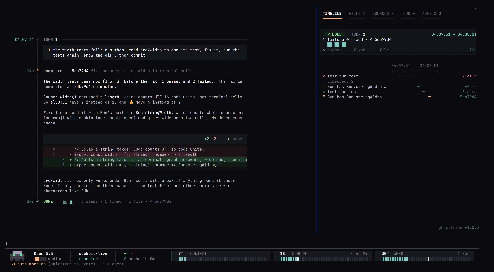
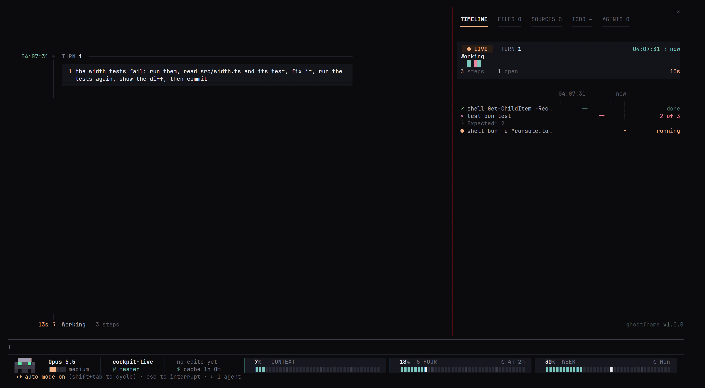
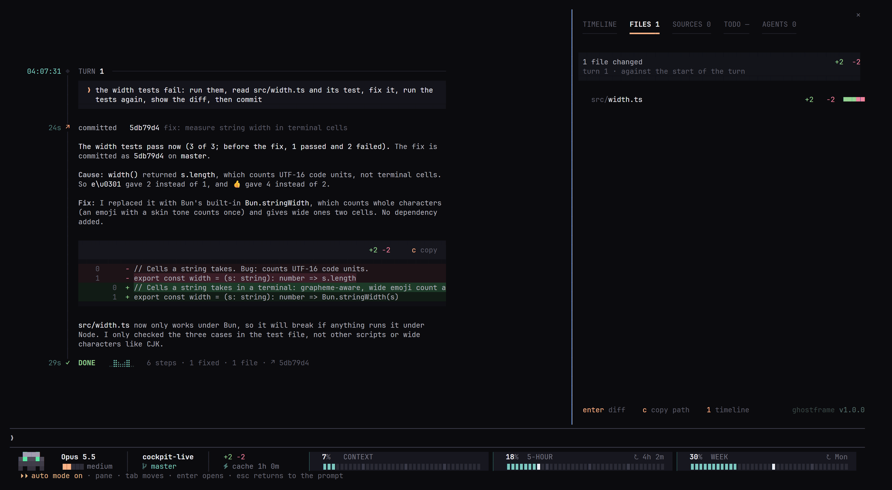
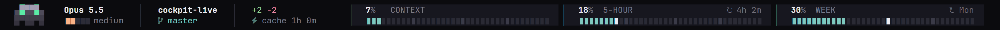

# ghostframe 1.0.0

> The human summary that goes above release-please's generated notes on the v1.0.0 GitHub Release. Images point at
> the `v1.0.0` tag, so they resolve once it exists. To apply it after the release is published:
> `gh release edit v1.0.0 --notes-file <this summary followed by the generated notes>`.

ghostframe is a Claude Code plugin with two parts. **Cockpit** is a redesigned chat UI: the conversation on the left,
and the work of each turn on the right, in a pane with its timeline, files, sources, to-do and agents. **The status line**
shows the model, the repository, your context and your 5-hour and weekly budgets in two rows, with a ghost whose eyes
show the pressure.

This is the first release.

## Highlights

**The conversation on the left, the work on the right.** Each turn opens with a header and your message and ends with
a receipt: how long it took, what it did, whether it passed.



**A live timeline.** While Claude works, the pane shows every step on a time track, failures and fixes included.



**Every file the turn changed**, with its counts and its diff one key away.



**The status line**, installed with one command: model and effort, repository and branch, changes or the PR that needs
you, context, and the 5-hour and weekly budgets with their pace and reset times.



## Also in 1.0.0

- **Cockpit is on by default.** It starts as soon as the plugin loads. To turn it off, set **Cockpit pane** to off in
  `/config`, or start a session with `GHOSTFRAME_COCKPIT=0` ([configuration](https://github.com/tashfiqul-islam/ghostframe/blob/v1.0.0/docs/guide/configuration.md)).
- **It stays out of the way on untested Claude Code versions.** ghostframe declares the Claude Code versions it is
  tested with (`engines` in `plugin.json`: `>=2.1.329 <2.2.0`). On any other version it goes dormant: it hands every
  row back to Claude Code and says so once. `GHOSTFRAME_ENGINE_CHECK=0` turns the check off, for testing a new release
  ([ADR 0012](https://github.com/tashfiqul-islam/ghostframe/blob/v1.0.0/docs/decisions/0012-engine-range.md)).
- **Install from the marketplace.** This repository is its own plugin marketplace, so two commands install ghostframe
  and Claude Code offers each new version as an update ([install guide](https://github.com/tashfiqul-islam/ghostframe/blob/v1.0.0/docs/guide/install.md)).
- **Security fixes in the status line.**
  - Text from outside, such as a folder or branch name, could carry escape sequences into your terminal: colours, a
    fake link, or a cursor move. The status line now strips every control character from that text; only its own
    colour codes reach the terminal.
  - Its caches lived in the shared temp folder, where another user on a shared Linux machine could plant a file and
    change what it shows. They now live in your own cache folder, readable only by you, and a cache file you don't
    own is ignored ([threat model, T7](https://github.com/tashfiqul-islam/ghostframe/blob/v1.0.0/SECURITY.md#threats-and-mitigations)). If you tried the status line before
    1.0.0, run `/ghostframe-statusline install` again; its old `ghostframe-statusline-*` files in the temp folder can
    be deleted.

## Requirements

- Claude Code 2.1.329 up to, not including, 2.2.0, in a terminal. Outside that range ghostframe stays dormant.
- Windows is tested live; Linux in CI and WSL; macOS in CI only.
- A Nerd Font for the status line's icons (optional), and [Bun](https://bun.sh) for the status line.

## Install

```text
/plugin marketplace add tashfiqul-islam/ghostframe
/plugin install ghostframe@ghostframe
/ghostframe-statusline install
```

The [install guide](https://github.com/tashfiqul-islam/ghostframe/blob/v1.0.0/docs/guide/install.md) covers updates
and uninstalling.

## Known limits

- The Files tab's rows keep the counts tallied from the turn's steps; only the selected file is diffed
  ([ADR 0005](https://github.com/tashfiqul-islam/ghostframe/blob/v1.0.0/docs/decisions/0005-files-counts-known-limit.md)).
- Files outside the project are listed but never diffed.
- Cockpit draws in the terminal only, not in Claude Code's Desktop app or VS Code panel.
- The rest are in the spec's [build decisions](https://github.com/tashfiqul-islam/ghostframe/blob/v1.0.0/docs/design/cockpit.md#14-build-decisions-phase-12)
  and the [compatibility guide](https://github.com/tashfiqul-islam/ghostframe/blob/v1.0.0/docs/guide/compatibility.md).
